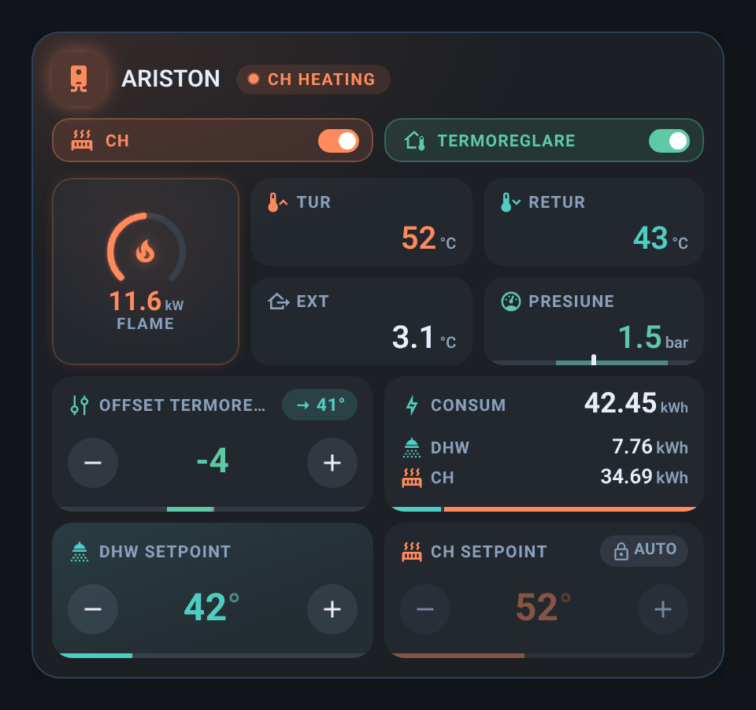
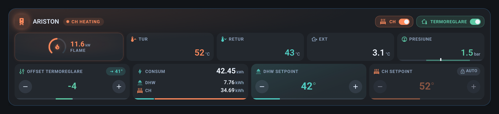
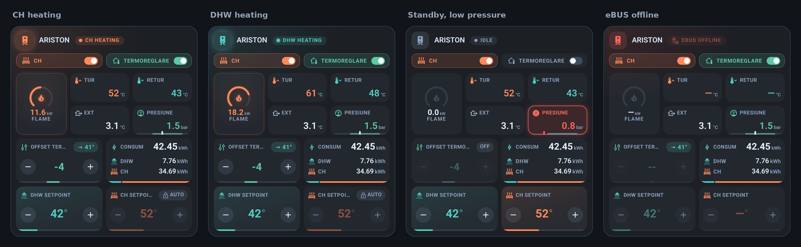
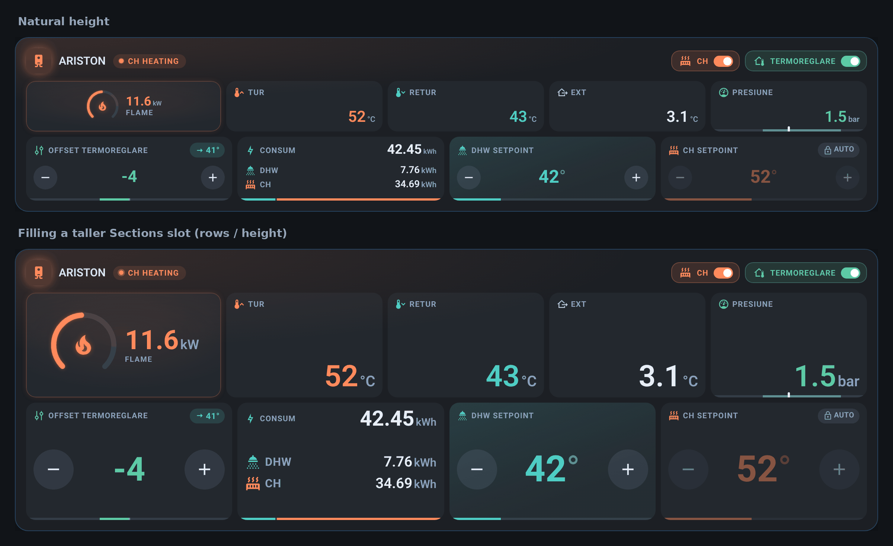
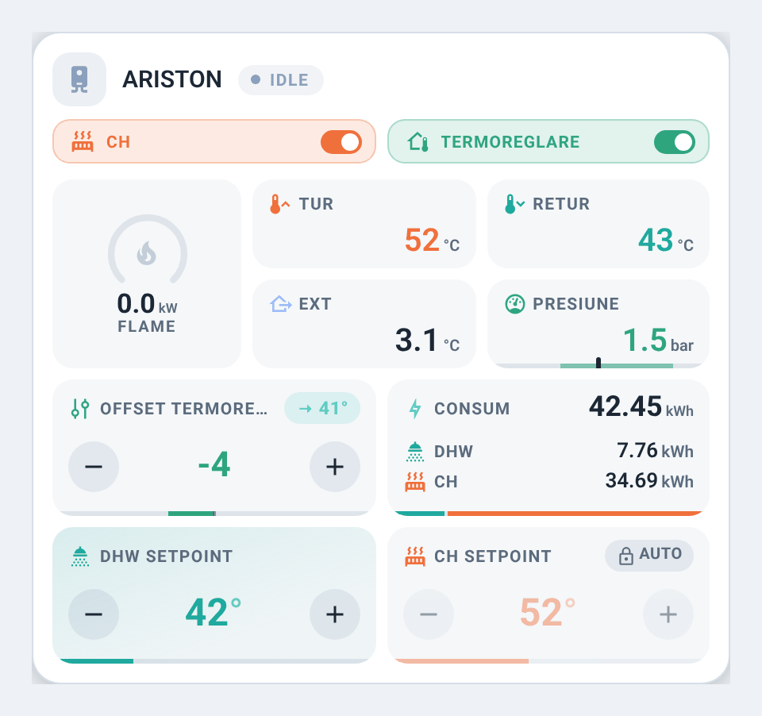

# EBusD Clas One Card

A Home Assistant Lovelace card and companion setup documentation for monitoring and
controlling an **Ariston Clas One** through **ebusd** and MQTT.

<p align="center"></p>

<p align="center">
  <a href="https://my.home-assistant.io/redirect/hacs_repository/?owner=phateks&amp;repository=EBusD-ClasONE-card&amp;category=plugin"></a>
</p>

This repository covers the complete path from the eBUS interface to the dashboard:

```text
Ariston Clas One
    -> compatible eBUS interface
    -> ebusd Home Assistant app
    -> MQTT broker and Home Assistant MQTT integration
    -> discovered Home Assistant entities
    -> EBusD Clas One Lovelace card
```

The card is only the dashboard layer. It does not install ebusd, configure MQTT, or
create boiler entities. Those parts must be set up and verified first.

## Documentation

- [End-to-end installation: ebusd, local CSV files, MQTT and the card](docs/SETUP.md)
- [Clas One CSV and entity reference](docs/CLASONE_ENTITIES.md)
- [Troubleshooting](docs/TROUBLESHOOTING.md)
- [Documentation index](docs/README.md)

## What the card does

<p align="center"></p>

### Header

- **Status badge** next to the title: `CH HEATING` (orange), `DHW HEATING` (teal),
  `IDLE`, any other raw status in uppercase, or `EBUS OFFLINE` (red, pulsing). The
  boiler icon and a soft glow in the card corner take the status colour, and the dot
  pulses while the boiler is heating. Click the badge to open the status entity (or
  `connection_entity` while offline).
- **CH** and **TERMOREGLARE** switches, shown as pills with a small toggle. Click to
  switch; an unavailable switch is dimmed and cannot be clicked.

### Sensors

- **Flame tile**: burner power in kW with a ring gauge that fills from 0 to
  `flame_max` (24 kW by default). The flame flickers while the burner is lit. While
  the boiler asks for heat (CH/DHW status or a lit burner) the tile gets a soft
  orange glow; turn it off with `flame_glow: false`.
- **Flow (TUR)**, **return (RETUR)** and **outdoor (EXT)** temperatures. The label
  stays top left and the value is right-aligned so it is easy to read at a glance.
- **Pressure**, with a thin scale along the bottom edge. The green band is the normal
  range (`pressure_min`–`pressure_max`, 1.0–2.5 bar by default) and the marker is the
  current value. Outside the range the tile turns red and pulses.
- Clicking any sensor tile opens its Home Assistant more-info dialog.

### Controls

- **Thermoregulation offset** with − / + buttons. The chip in the corner shows the
  flow setpoint computed by the boiler (`→ 41°`). The line along the bottom edge
  shows the offset from 0 towards the current value. With thermoregulation off, the
  chip reads `OFF` and the buttons are disabled.
- **Consumption** (optional): the total in the corner, DHW and CH below it, and a
  bar along the bottom edge that splits the total between DHW (teal) and CH (orange).
- **DHW and CH setpoints** with − / + buttons and a bottom-edge line showing where the
  value sits in its range. While thermoregulation is on, the CH setpoint is driven by
  the offset: its buttons are disabled and an `AUTO` chip explains why.
- Button clicks are combined: the card waits briefly after the last click and then
  sends one value. Until the boiler reports it back, the new value is shown dimmed.
  If it is not confirmed in about 15 seconds, the display returns to the boiler value.
- Controls are disabled while their entity is unavailable or the card is offline, so
  the card never writes a value based on an unknown state.

### States at a glance

<p align="center"></p>

## Layout and sizing

The card adapts to the width it is given:

| Card width | Layout |
| --- | --- |
| under 600 px (phones) | Title and status on one row, the two switches below. Flame tile on the left, the four sensor tiles in a 2 × 2 grid. Controls in two columns. |
| 600 px and wider (tablets) | Header on one row. Flame tile and the four sensors on one row. |
| 780 px and wider (desktops) | Offset, consumption and both setpoints on one row too, so the whole card is three rows tall. |

It also adapts to the height it is given. In a **Sections** dashboard, set the card's
rows (drag its corner in the layout editor, or `grid_options: rows: N` in YAML) to
match a neighbouring card. On other dashboards use the `height` option. The tiles
stretch to fill the space and the values, the flame ring, the consumption text and
the − / + buttons scale with them. The card never gets shorter than its content, and
without a height from outside it keeps its natural size.

<p align="center"></p>

The card follows the Home Assistant light or dark theme. Its tiles are translucent
tints over the card background, so a transparent theme or card_mod background
carries through to them. Animations stop when the system asks for reduced motion.

<p align="center"></p>

All entities can be selected in the visual editor or set in YAML, and all visible
labels can be changed. Values and controls depend on the entities exposed by your
ebusd/MQTT setup.

## Install the card

### One click (HACS)

[](https://my.home-assistant.io/redirect/hacs_repository/?owner=phateks&repository=EBusD-ClasONE-card&category=plugin)

The button opens your Home Assistant, adds this repository to HACS and shows its page.
Click **Download**, then reload the browser. HACS registers the dashboard resource for
you. This needs HACS and the My Home Assistant integration, which is part of
`default_config`. The first time, the link asks for your Home Assistant address.

### HACS, step by step

1. In HACS, open the **⋮** menu → **Custom repositories**.
2. Add `https://github.com/phateks/EBusD-ClasONE-card` with type **Dashboard**.
3. Open the repository, click **Download**, then reload the browser.

### Manual

Download `ebusd-clasone-card.js` from the latest
[release](https://github.com/phateks/EBusD-ClasONE-card/releases/latest), copy it to
`/config/www/` and add it as a JavaScript module resource:

```yaml
url: /local/ebusd-clasone-card.js
type: module
```

For the separate ebusd app, Mosquitto, local configuration files, and MQTT discovery
steps, follow the [end-to-end setup guide](docs/SETUP.md).

## Example card configuration

Entity IDs below are examples. Select the entities actually created in your Home
Assistant instance; names vary with the ebusd configuration, MQTT discovery settings,
and entity registry.

```yaml
type: custom:ebusd-clasone-card
title: ARISTON CLAS ONE
status_entity: sensor.ebusd_boiler_boiler_status
ch_switch_entity: switch.ebusd_boiler_heating_status
thermoreg_entity: switch.ebusd_boiler_thermoregulation_switch
flame_power_entity: sensor.ebusd_boiler_flame_power_kw
flow_temp_entity: sensor.ebusd_boiler_lwt_temp
return_temp_entity: sensor.ebusd_boiler_ewt_temp
outdoor_temp_entity: sensor.ebusd_boiler_ext_temp
pressure_entity: sensor.ebusd_boiler_boiler_pressure
offset_entity: number.ebusd_boiler_z1_heat_offset_set
computed_setpoint_entity: sensor.ebusd_boiler_ch_flow_setpoint
dhw_setpoint_entity: number.ebusd_boiler_dhw_comfort_temp_set
dhw_setpoint_display_entity: sensor.ebusd_boiler_dhw_current_target_temp
ch_setpoint_entity: number.ebusd_boiler_z1_heat_setpoint_set
dhw_consumption_entity: sensor.gaz_acm_zilnic
ch_consumption_entity: sensor.gaz_incalzire_zilnic
flow_temp_label: TUR
return_temp_label: RETUR
outdoor_temp_label: EXT
pressure_label: PRESSURE
```

### Optional settings

| Option | Default | Description |
| --- | --- | --- |
| `connection_entity` | none | Entity that is `on` while ebusd has an eBUS signal. When it is off or unavailable, the status badge shows `EBUS OFFLINE`. |
| `pressure_min` / `pressure_max` | `1.0` / `2.5` | The pressure tile turns red outside this range (bar). |
| `offset_min` / `offset_max` / `offset_step` | `-14` / `14` / `2` | Offset range and step for the − / + buttons. The starting value is read from `offset_entity`. |
| `dhw_consumption_entity` / `ch_consumption_entity` | none | Sensors for DHW and CH consumption. When at least one is set, a consumption box appears next to the offset box with DHW, CH and their total. Without them, the offset box takes the full width. The unit comes from the sensor (`kW` if missing). |
| `consumption_label` / `consumption_decimals` | `CONSUM` / `1` | Title and decimals of the consumption box. |
| `dhw_min` / `dhw_max` / `dhw_step` | entity attributes, else `36` / `60` / `1` | DHW setpoint range. |
| `ch_min` / `ch_max` / `ch_step` | entity attributes, else `30` / `80` / `1` | CH setpoint range. |
| `flame_max` | `24` | Full scale of the flame ring, in kW. Set it to your boiler's maximum power. |
| `flame_glow` | `true` | Soft glow on the flame tile while the boiler asks for heat. `false` turns it off. (`electric_border: false` from 1.0.0 also still turns it off.) |
| `height` | automatic | Fixed card height, for example `360` or `360px`. The tiles inside stretch to fill it and the values, flame ring and buttons scale with them. The card never gets shorter than its content. In a Sections dashboard, set the rows instead. |
| `ch_switch_label`, `thermoreg_label`, `flame_label`, `flow_temp_label`, `return_temp_label`, `outdoor_temp_label`, `pressure_label`, `offset_label`, `dhw_setpoint_label`, `ch_setpoint_label` | `CH`, `TERMOREGLARE`, `FLAME`, `TUR`, `RETUR`, `EXT`, `PRESIUNE`, `OFFSET TERMOREGLARE`, `DHW SETPOINT`, `CH SETPOINT` | Label overrides. On narrow cards a long label is shortened with `…`. |

Without `connection_entity`, the card shows `EBUS OFFLINE` when the status sensor
becomes unavailable or unknown. ebusd publishes its signal state on the MQTT topic
`ebusd/global/signal`. If no entity exists for it, an MQTT binary sensor can be added
to `configuration.yaml`. Check the exact topic and payloads in MQTT Explorer first:

```yaml
mqtt:
  binary_sensor:
    - name: "ebusd signal"
      unique_id: ebusd_global_signal
      state_topic: "ebusd/global/signal"
      payload_on: "true"
      payload_off: "false"
      device_class: connectivity
```

The sample IDs are not guaranteed to match your installation. In particular, check the
entity domains for the two switches and writable setpoints before assigning them. See
the [entity reference](docs/CLASONE_ENTITIES.md) for the relationship between CSV
messages and card fields.

## Gas consumption

The Clas One keeps two cumulative gas-energy counters, one for CH and one for DHW.
The included [`clas_one.csv`](docs/ebusd/ariston/clas_one.csv) reads them as
`gas_energy_ch` and `gas_energy_dhw` (kWh). The boiler updates them about every two
hours, so the values move in steps rather than continuously.

To show today's consumption on the card, add daily utility meters on top of the
counters in `configuration.yaml`. Use the entity IDs that MQTT discovery created in
your installation:

```yaml
utility_meter:
  gaz_incalzire_zilnic:
    unique_id: gaz_incalzire_zilnic
    name: "Gaz încălzire azi"
    source: sensor.ebusd_boiler_gas_energy_ch
    cycle: daily
  gaz_acm_zilnic:
    unique_id: gaz_acm_zilnic
    name: "Gaz ACM azi"
    source: sensor.ebusd_boiler_gas_energy_dhw
    cycle: daily
```

Then select the two utility meters as `ch_consumption_entity` and
`dhw_consumption_entity`. The card adds them up for the total in the box corner. You can also point
the card at the raw counters or at any other energy sensor; the unit is taken from
the sensor.

## Project files

- `src/` — card, editor, types and styles
- `ebusd-clasone-card.js` — built frontend bundle distributed by HACS/manual install
- [`ebusd/ariston/clas_one.csv`](docs/ebusd/ariston/clas_one.csv) — local Clas One
  ebusd message definitions
- [`ebusd/_templates.csv`](docs/ebusd/_templates.csv) — shared CSV templates used by
  the local definitions

The local CSV files are optional and are not a complete replacement for the standard
ebusd configuration CDN. Review the [installation guide](docs/SETUP.md) and the
[CSV-specific notes](docs/CLASONE_ENTITIES.md) before using them. The provided files
include write definitions and a message-ID discrepancy that must be checked against
your boiler and ebusd logs.

## Development

```bash
npm ci
npm run build
```

The build writes `ebusd-clasone-card.js` to the repository root.

## License

MIT. See [LICENSE](LICENSE).
